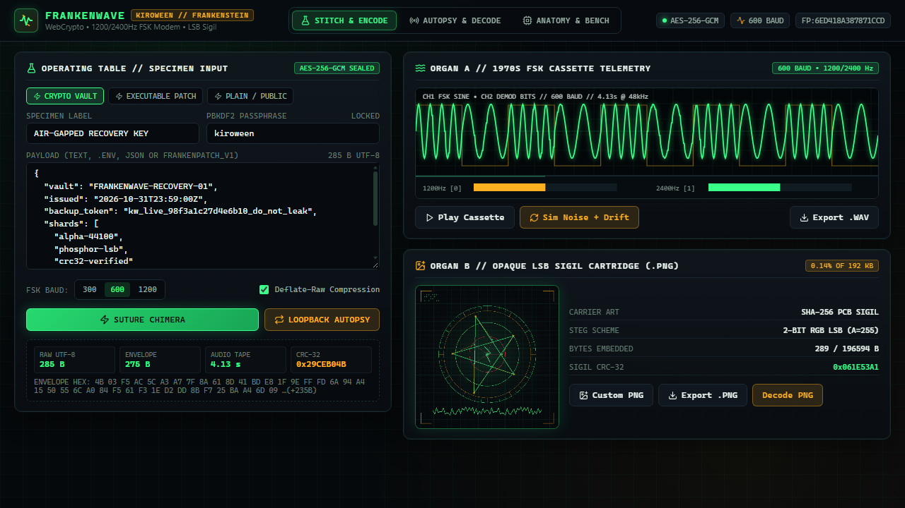

# FRANKENWAVE — Chimera Crypt-Tape & Steg Sigil Studio

> **Kiroween 2026 Submission — Frankenstein Track**
> *Stitching incompatible technologies into one living, zero-server specimen.*



## What FRANKENWAVE Stitches Together
FRANKENWAVE combines **four unrelated engineering worlds** into a cohesive, air-gapped browser laboratory running at **\$0 operational cost** (100% client-side, zero backend, zero paid API keys):

1. **Modern Authenticated Cryptography (`Web Crypto API`)** — `PBKDF2-SHA256` (`120,000` iterations) + `AES-256-GCM` authenticated encryption + optional `deflate-raw` payload compression.
2. **1970s Acoustic Cassette Telemetry (`Web Audio API` + Pure-TS DSP)** — Phase-continuous `1200 Hz` / `2400 Hz` FSK modulation (`300 / 600 / 1200 baud`) serialized to standard `RIFF/WAVE PCM16`, decoded by a windowed Goertzel DFT detector with transition-centered Gardner/Mueller timing recovery (`±0.6%` clock-skew resilient at `12 dB` SNR) and IEEE 802.3 `CRC-32`.
3. **Opaque 2-Bit/Channel LSB Image Steganography (`Canvas 2D`)** — Deterministically generates a `512×512` Cyberpunk-Occult PCB Sigil seeded from the envelope's `SHA-256` digest (or accepts any custom PNG carrier), embedding up to `~192 KB` across R/G/B LSBs while strictly locking `Alpha = 255` so browser Canvas PNG round-trips remain bit-exact.
4. **Zero-Eval Sandboxed Micro-Patch Runner (`FRANKENPATCH_V1`)** — Decoded patch presets safely drive a live 60fps harmonic Canvas2D mandala and WebAudio FM drone without `eval` or `new Function`.

## `.kiro/` Spec-Driven Architecture
This repository maintains its full Kiro spec-driven paper trail inside `.kiro/`:
- `.kiro/specs/frankenwave-chimera/requirements.md` — EARS functional requirements
- `.kiro/specs/frankenwave-chimera/design.md` — Binary wire specs, FSK DSP math, and LSB frame layout
- `.kiro/specs/frankenwave-chimera/tasks.md` — Sequenced implementation waves
- `.kiro/steering/architecture.md` & `.kiro/steering/testing.md` — Architectural & DSP invariants
- `.kiro/hooks/test-on-codec-edit.kiro.hook` & `.kiro/hooks/spec-sync-check.kiro.hook` — Automated test & spec-sync hooks

## Local Development & Verification
```powershell
npm.cmd install
npm.cmd run typecheck
npm.cmd test
npm.cmd run build
```

## Static Deployment (GitHub Pages)
Included `.github/workflows/deploy.yml` builds `dist/` (`base: './'`) and deploys automatically when pushed to `main` on a public GitHub repository with **Settings → Pages → Source: GitHub Actions**.
